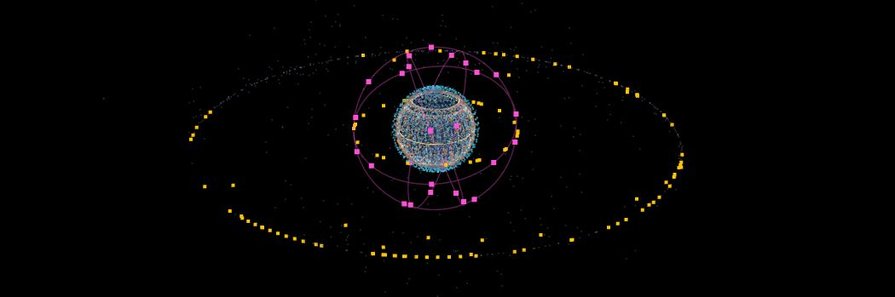

# Orbit Lab


**A browser-based orbital mechanics and flight dynamics sandbox: the live satellite catalog with a validated SGP4 pipeline, a simulated model of SES's meoSphere constellation, the whole solar system with real ephemerides, lunar missions from tracking data and from own reconstructions, a ground-station planner for SES HQ Betzdorf, and a relay-coverage analysis of lunar communication constellations.**

> **Live demo:** [oliviersci.github.io/orbit-lab](https://oliviersci.github.io/orbit-lab/)



Independent student project, not affiliated with or endorsed by SES or any other company mentioned. Wherever a value is assumed, modeled or representative rather than published, the app and this README say so.

---

## Contents

- [What it does](#what-it-does)
- [Validation](#validation)
- [Lunar missions](#lunar-missions)
- [Ground station planner: SES HQ Betzdorf](#ground-station-planner-ses-hq-betzdorf)
- [Lunar orbiters and relay coverage](#lunar-orbiters-and-relay-coverage)
- [Technical highlights](#technical-highlights)
- [Data pipeline and deployment](#data-pipeline-and-deployment)
- [Getting started](#getting-started)
- [Assumptions and limitations](#assumptions-and-limitations)
- [Roadmap](#roadmap)
- [Data sources and references](#data-sources-and-references)

## What it does

**Earth orbit.** About 16,000 active objects from CelesTrak, propagated in real time with SGP4 in a Web Worker: SES (including the former Intelsat fleet and all 30 O3b / O3b mPOWER satellites), Starlink, OneWeb, Amazon Leo and all other active objects, each on its own toggleable layer. Next to them, a simulated **meoSphere** phase 1 constellation (28 satellites, 4 planes, ~8,000 km) propagated with an own J2 model built on geometric algebra. Any satellite can be selected to show its orbit, elements and element age.

**The solar system.** All planets from JPL's approximate planetary elements, the Moon from the Astronomical Almanac formula, IAU rotation models for every body (including the Moon's thirteen libration terms), true sizes and oblateness, 8k textures loaded only for the focused body, Saturn's rings, and Earth with a day/night shader: city lights fade in through twilight, clouds hide them, oceans show sun glint. The sky is the real one: the Yale Bright Star Catalogue and NASA's Milky Way map, both precessed from J2000 into the same frame as everything else.

**Lunar missions.** Government and commercial missions, flown and planned, with their landing or impact sites on the Moon. Trajectories come from JPL Horizons where available and from **own reconstructions** where operators never published tracking data.

**Ground station.** Live pointing, range rate, Doppler shift and listening windows from SES HQ Betzdorf to any lunar site, with a line of sight drawn in the 3D view.

**Lunar orbit population.** Operating orbiters from JPL Horizons (Moon-centred) and planned relay constellations, plus an analysis of how much they improve communications for the lunar south pole.

## Validation

### SGP4 against the official reference set

Tested against the 33 cases of Vallado et al., *"Revisiting Spacetrack Report #3"* (AIAA 2006-6753).

| Result | Cases |
|---|---|
| Match to the reference's print precision | 31 |
| Correctly rejected (reference expects an error) | 1 (33334) |
| Explained discrepancy | 1 (23599) |

**The tolerance comes from the data.** The reference prints positions to 10⁻⁸ km and velocities to 10⁻⁹ km/s; rounding bounds the vector error by √3/2 of a unit (0.0087 mm, 0.87 µm/s). All 31 passing cases fall within that bound.

**Case 23599 traced to a node crossing.** The error divided by the orbital radius is constant (a rigid rotation of ≈ 3.95 × 10⁻⁵ rad) and appears abruptly around t ≈ 410 min. J2 nodal regression, dΩ/dt = −(3/2) n J2 (R⊕/p)² cos i, carries the ascending node from 0.2849° through 0° after **≈ 417 minutes**, where SGP4's operating modes treat the node angle differently.

**A formatting artifact in the reference file.** One line in the official output contains 24 concatenated states with a ~12-hour period, which cannot belong to satellite 20413 (period ~4 days). The harness detects and reports such lines.

### Geometric algebra and the J2 model

- Rotors match the classical 3-1-3 rotation matrices to 10⁻⁹ km across 1,000 random orientations; a Python port with rotation matrices reproduces the TypeScript (rotor) ephemeris to below 0.05 µm.
- With J2 = 0, orbits close after one period to below 1 mm; the orbital plane, read from the bivector r∧v, regresses at exactly the analytical J2 rate.
- **Against Orekit (Python)** with identical physics, the along-track drift of 1,342 km over 7 days is fully explained by the mean-vs-osculating semi-major axis: first-order theory predicts 4.06 km, and a least-squares fit of mean elements to the Orekit trajectory independently finds **−4.0563 km against −4.0572 km**. Remaining residuals are bounded short-period terms.

### Integrator

The adaptive Dormand–Prince 5(4) integrator closes a circular orbit after 10 periods to within 10 m, integrates backward to its starting state, and its error shrinks by more than 10× when the tolerance is tightened 100×.

## Lunar missions

**From tracking data:** Artemis I and II, Chandrayaan-3, SLIM, Danuri, CAPSTONE and others come from JPL Horizons. During a mission, the Moon is placed from the same ephemeris, so the arrival geometry is exact.

**Reconstructed from published milestones (Intuitive Machines).** No public tracking data exists, so the trajectory is solved in an Earth–Moon–Sun model: backward from the landing (site, time, published orbit altitudes, descent orbit insertion and powered descent), then a three-body transfer solved by Newton iteration from lunar orbit insertion back to a 200 km perigee at trans-lunar injection. Arrival is coplanar, and among solutions the lowest-Δv one is kept. Independent checks against published numbers:

| | Model | Published |
|---|---|---|
| IM-1 LOI Δv | 854 m/s | 800 m/s |
| IM-1 orbit altitude implied by the timing | 98.6 km | 92 km |
| IM-1 approach | from the northeast, over Schomberger crater (used as a constraint) | Schomberger imaged ~200 km uprange |
| IM-1 transfer distance | 470,000 km | over 1,000,000 km |
| IM-2 transfer time | 4.47 days | 4.5 days |
| IM-2 lunar revolutions | 40.5 | about 39 |

The distance mismatch survives every model variant: **Odysseus did not fly a simple direct transfer**, and its LOI time also presses against the published bounds. The model shows where reality was more complex.

**Lunar operations (ispace).** HAKUTO-R and Resilience flew multi-month low-energy transfers, which are not reconstructed yet. Their lunar phase is modeled from published milestones: capture orbit, gradual lowering to 100 km, descent, and for HAKUTO-R a free fall from 5 km after its propellant ran out (≈ 127 m/s impact).

## Ground station planner: SES HQ Betzdorf

Pointing, Doppler and listening windows from Betzdorf (WGS84, Earth rotation via GMST) to a lunar site, live in the app and as a command-line planner. Checks against first principles:

- **Doppler** from Earth's rotation: 0.465 km/s × cos 49.69° ≈ 0.30 km/s → ±2.2 kHz at 2.2 GHz; planner: −2.4 … +2.5 kHz including the Moon's motion. **Doppler rate** 2.2 kHz × 7.29 × 10⁻⁵ rad/s ≈ 0.16 Hz/s; planner: 0.13–0.15 Hz/s.
- **Earth seen from Reiner Gamma** (IM-3, 59°W): 90° − 59° ≈ 31° ± libration; planner: 25–36°.
- **Earth seen from Athena's site** (84.8°S): −2.2° to +10.7°; Earth sets for days at a time, and those days have no listening windows from anywhere on Earth.

The downlink frequency in the app is a placeholder until a mission's filed frequency is known.

## Lunar orbiters and relay coverage

Operating orbiters (LRO, Chandrayaan-2, Danuri, CAPSTONE, ARTEMIS P1/P2) come from JPL Horizons **relative to the Moon's centre**, so they circle the rendered Moon correctly even though the analytical Moon is only accurate to ~0.3°. Planned constellations (Intuitive Machines' Lunar Data Network, ESA's Lunar Pathfinder and Moonlight) use **representative** elliptical lunar frozen orbits with apolune over the south pole, since their exact elements are not published. Queqiao-2 uses its published orbit shape with an assumed orientation.

**Relay coverage for Athena's site (84.8°S), 30 days, relay elevation ≥ 10°, flat horizon:**

| Network | Direct to Earth | Via relay | Combined | Longest gap without any link | Relays in view (mean) |
|---|---|---|---|---|---|
| Direct to Earth only | 64.0% | — | 64.0% | 149.9 h | — |
| 1 frozen-orbit relay (Lunar Pathfinder class) | 64.0% | 72.4% | 90.0% | 3.8 h | 0.72 |
| 5 frozen-orbit relays (IM or Moonlight class) | 64.0% | 100% | 100% | 0 h | 3.61 |
| 10 relays (IM + Moonlight, interoperable) | 64.0% | 100% | 100% | 0 h | 7.22 |

A south-polar lander relying only on direct contact loses Earth for up to **six days** at a time, before terrain is even considered; one relay cuts that to under four hours, and five eliminate it. The IM and Moonlight rows are identical because both use the same representative orbit class. Queqiao-2's result at the south pole (0%) depends entirely on its unpublished orientation and is treated as inconclusive.

## Technical highlights

- **Geometric algebra** for orbit geometry: orbital planes as bivectors (r∧v), orientations as rotors (v' = R v R̃), used for satellite orbits, planetary orbits, IAU body orientations and lunar landing geometry.
- **One consistent frame.** Everything is drawn in the mean equator and equinox of date (≈ TEME): stars, planetary elements and Horizons data are precessed from J2000 with the IAU 1976 model.
- **Rigorous time.** TT seconds since J2000 internally, full leap-second table, TDB for planetary work.
- **Scale from LEO to Neptune** with logarithmic depth and camera-relative double-precision transforms; physics in km and float64 throughout.
- **Own flight dynamics tools:** J2 secular propagator, adaptive Dormand–Prince integrator, cislunar Earth–Moon–Sun force model, Newton shooting with minimal-norm steps, Hermite interpolation of trajectories.

## Data pipeline and deployment

A GitHub Actions workflow tests, fetches and deploys to GitHub Pages on every push and every six hours:

1. The full test suite runs first; a failing test stops deployment.
2. The satellite catalog is fetched from CelesTrak, all-or-nothing, rate-limit aware, with fallback to the last deployed catalog.
3. Lunar orbiter ephemerides are refreshed from JPL Horizons (failures fall back to the committed data).
4. Vite builds the site; GitHub Pages serves it.

Mission trajectories, reconstructions, textures and star data are static and committed.

## Getting started

```bash
npm install
npm run fetch-catalog        # satellite catalog (CelesTrak)
npm run fetch-orbiters       # lunar orbiters (JPL Horizons)
npm run dev                  # http://localhost:5173/orbit-lab/
npm test                     # validation suite
```

Further data and analysis scripts:

```bash
npm run fetch-stars                          # Yale Bright Star Catalogue (VizieR)
npm run fetch-missions                       # lunar mission trajectories (JPL Horizons)
npm run reconstruct-missions                 # Intuitive Machines reconstructions, ispace lunar operations
npx tsx scripts/plan-listening.ts im-3 30    # listening windows from Betzdorf
npm run relay-coverage im-2 30               # relay coverage for a lunar site
python scripts/fetch_textures.py             # planet textures (Python venv, see validation/requirements.txt)
```

**Keys:** `space` pause · `[` `]` warp · `r` now · `,` `.` previous/next body · `e` Earth · `o` Moon · `1`–`5` operator layers · `m` meoSphere · `g` Earth grid · `l` lunar missions · `b` ground station · `n` lunar orbiters · click to select · `h` help.

## Assumptions and limitations

- **meoSphere:** inclination (70°) and phasing assumed; SES has published 28 satellites, 4 planes and ~8,000 km.
- **Reconstructions** are models from public milestones, not tracking data; assumptions are listed per mission in the app.
- **Planned lunar constellations** use representative orbits; their exact elements are not published.
- **Analytical ephemerides:** Moon ~0.3°, planets ~arcminutes; Horizons data is used where precision matters.
- **Coverage and planner** assume a flat local horizon; real terrain near the poles reduces visibility further.
- **Catalog accuracy:** public elements are predictions, typically hours to a day old.

## Roadmap

- [x] Live catalog, SGP4 validation, J2 propagator with geometric algebra, meoSphere layer
- [x] Python/Orekit validation and mean-element fitting
- [x] Solar system, real sky, Earth night side
- [x] Lunar missions: Horizons trajectories, Intuitive Machines reconstructions, ispace lunar operations
- [x] Ground station planner and live panel for SES HQ Betzdorf
- [x] Lunar orbiters and relay coverage analysis
- [ ] ispace low-energy transfers: multi-segment solver checked against HAKUTO-R's ~1.4 million km and Resilience's lunar flyby
- [ ] Blue Ghost Mission 1 reconstruction (Earth phasing orbits)
- [ ] Terrain horizons from lunar elevation data for the planner and coverage analysis
- [ ] Own SGP4 implementation and WebGPU port

## Data sources and references

- **Satellite catalog:** CelesTrak (T.S. Kelso). **SGP4 verification:** Vallado, Crawford, Hujsak and Kelso, "Revisiting Spacetrack Report #3," AIAA 2006-6753.
- **Trajectories and lunar orbiters:** NASA/JPL Horizons.
- **Planetary elements:** E.M. Standish, "Approximate Positions of the Planets" (JPL). **Rotation models:** IAU WGCCRE (Archinal et al.).
- **Planet textures:** Solar System Scope, CC BY 4.0. **Milky Way:** NASA/Goddard Space Flight Center Scientific Visualization Studio, Deep Star Maps 2020. **Stars:** Yale Bright Star Catalogue (Hoffleit & Warren), via CDS VizieR.
- **Mission milestones:** Intuitive Machines, ispace, NASA (NSSDCA), ESA and CNSA announcements, and the press coverage cited per mission in `src/missions/catalog.ts` and `src/lunar/orbiters.ts`.
- **Validation:** Orekit (CS Group); geometric algebra after Hestenes and Doran & Lasenby.

## Author

Built by [@oliviersci](https://github.com/oliviersci), physics student.
